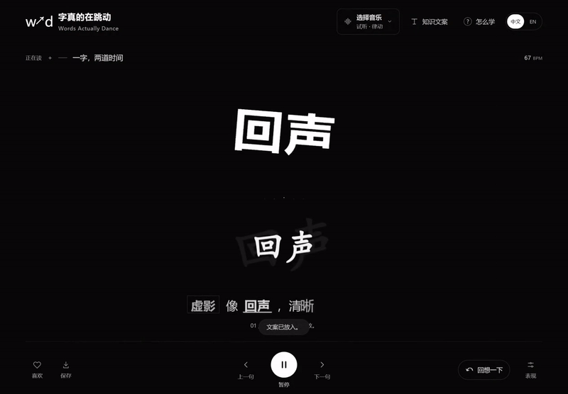

<p align="center"><a href="https://words-actually-dance-lab.aivnailedeng.chatgpt.site/"><strong>▶ 在线体验 · Try it in your browser</strong></a><br>中文 / English · 无需安装 · No installation</p>

<p align="center"></p>

# 字真的在跳动

**Words Actually Dance · 让知识，跟上你的节奏。**

把一段笔记变成随音乐展开的文字。关键词踩着声音起势，讲解一句句出现；读到值得停一下的地方，按「回想一下」，试着用自己的话说出来。

[打开网站](https://words-actually-dance-lab.aivnailedeng.chatgpt.site/) · [下载 Windows 便携版](https://github.com/LexZeon/words-actually-dance-open/releases/latest) · [开始使用](GETTING-STARTED.md) · [怎么学](docs/learning-science.md) · [English](#english)

<p align="center"></p>

## 先看它怎么动

三条来自实际程序的演示，配乐由本项目代码生成，文字为原创示例。它们展示软件表现，不是学习效果实验。

每条约10–12秒，直接录制实际界面，不加长片头；分别使用低频重鼓、和弦合成器和明亮琶音。

音乐效果参考：[用户选定的《Die for You》Bilibili 视频](https://www.bilibili.com/video/BV1Zopb6KEFo/)。该歌曲未获本项目公开视频配乐授权，因此不嵌入视频、不随仓库或软件分发；链接用于标明参考来源，不表示许可或合作。

另外两段风格参考：[片段一，1:19–1:53](https://www.bilibili.com/video/BV1Eqh9z1EcP/)、[片段二，从2:04开始的副歌](https://www.bilibili.com/video/BV1Kmpc6zEi3/)。这些外部录音同样不作为公开视频配乐或仓库素材分发。

| 演示                                          | 看什么                           |
| --------------------------------------------- | -------------------------------- |
| [让知识跟上节奏](media/demo-overview.mp4)     | 低频重鼓、声音轻重、逐句讲解与关键词交接 |
| [一字，两道时间](media/demo-ghosts.mp4)       | 和弦合成器、五种清晰白字与延迟淡白虚影 |
| [读过之后，回想一下](media/demo-learning.mp4) | 明亮琶音、实际暂停、遮住讲解、回想后核对 |

## 三步开始

1. **选音乐。** 先按「开始试听」，或选择自己的本地音乐。Windows 也能在主动开启后分析系统声音；换输出设备后重新连接。
2. **放知识。** 中英文界面都可试读内置文案，或导入 TXT／标准 JSON。也能复制提示词，在自己选择的 AI 工具里整理材料后再导入。软件本身不调用 AI，也不会自动翻译你的材料。
3. **读一小段，停一下。** 调整每拍文字和动作强度，随时暂停、回看。点「回想一下」会暂停播放并遮住讲解；「看答案」只揭开内容，由你决定何时继续。

## 好看，也给理解留点空间

关键词舞台与知识文字各有自己的表现：真实起音和鼓点重量影响动作，频率分布、幅度、相位与音色代理持续改变姿态；统一内部拍子让播放保持连贯。五种白字虚影可自动选择、固定或关闭，知识区保留22种文字效果。安静时内部拍子会继续，这不表示程序检测到了真实鼓点。

一次只读一小段、回想后核对、隔一段时间再试，是可以尝试的学习流程。检索练习与间隔学习有研究支持；**本软件的音乐、动画及整体学习效果尚未经有效性研究**。如果动画或音乐干扰理解，就调轻动作、调低音量，或安静地读；无歌词音乐也不保证更适合学习。[研究、例子与边界](docs/learning-science.md)。

## 在自己电脑上运行

普通用户优先下载 Windows 便携版，解压后保留整个文件夹，双击启动文件。当前没有代码签名或安装器；请只从本仓库 Releases 获取并核对发布的 SHA-256。

开发者需要 Node.js 22.13+、pnpm 11.25：

```sh
git clone https://github.com/LexZeon/words-actually-dance-open.git
cd words-actually-dance-open
pnpm install --frozen-lockfile
pnpm preview
```

浏览器打开终端给出的本地地址。Windows 原生版使用 `pnpm start`，首次选择自己的屏幕；`pnpm package:win` 生成便携目录。浏览器预览使用本地文件与内置试听；系统共享声音取决于浏览器和用户授权。

## 开源范围

这是一个实验性开源播放器，适合使用、研究与继续改进。目前支持 Windows 实验版和可本地运行的网页；Android、iOS、macOS 原生发行版、账号、推荐、付费、在线 AI 与配音均未接入。复杂音乐的节拍／倍拍判断仍可能出错，音色名称只是声音特征代理。

公开网站可直接访问，提供中英文、提示词和本地文案导入；不提供音乐上传，使用内置试听或浏览器授权共享声音。桌面版保留本地音乐选择。公开版本独立发布，不包含原私有开发历史、聊天、协作者资料、私人云库身份和上传文件，不连接原协作库，不会默默上传你的音乐和笔记。[隐私说明](PRIVACY.md)。

自有代码、原创示例文字与本仓库自产演示媒体采用 [MIT](LICENSE)。Electron／Chromium 等第三方组件保留各自许可，[署名与方法灵感](THIRD-PARTY-NOTICES.md)分别记录。MIT 不授予用户导入音乐、教材、字体或第三方素材的权利。

欢迎提交问题或接手改进。不承诺固定更新周期；复现步骤、音乐特征描述和不含私人材料的小样例，会让问题更容易处理。[贡献指南](CONTRIBUTING.md)。

## English

Words Actually Dance is an open-source, music-reactive typography player. Bring your notes and music, watch ideas unfold, then pause and recall the meaning in your own words. It combines a continuous shared beat clock, audio-driven keyword motion, five delayed white ghost effects, and an independent knowledge-text renderer.

The **Recall** action pauses playback and conceals the explanation; revealing it never resumes playback automatically. Retrieval practice and spacing have research support, but this product's music, animation and learning effectiveness have **not** been validated. See the [learning guide](docs/learning-science.md) for sources and limitations.

[Try the public website](https://words-actually-dance-lab.aivnailedeng.chatgpt.site/) in Chinese or English, without installation. Import your own text locally or copy a prompt for your preferred external AI tool. The website offers generated demo audio and consent-based shared audio, with no music-upload feature; Windows keeps local music selection. The app never automatically translates your material.

Windows portable builds and a browser-local preview are also available. No embedded AI API, TTS, account, recommendation or billing service. No private development history or collaboration storage is included. First-party code and original demo media are MIT licensed; third-party licenses remain separate.
