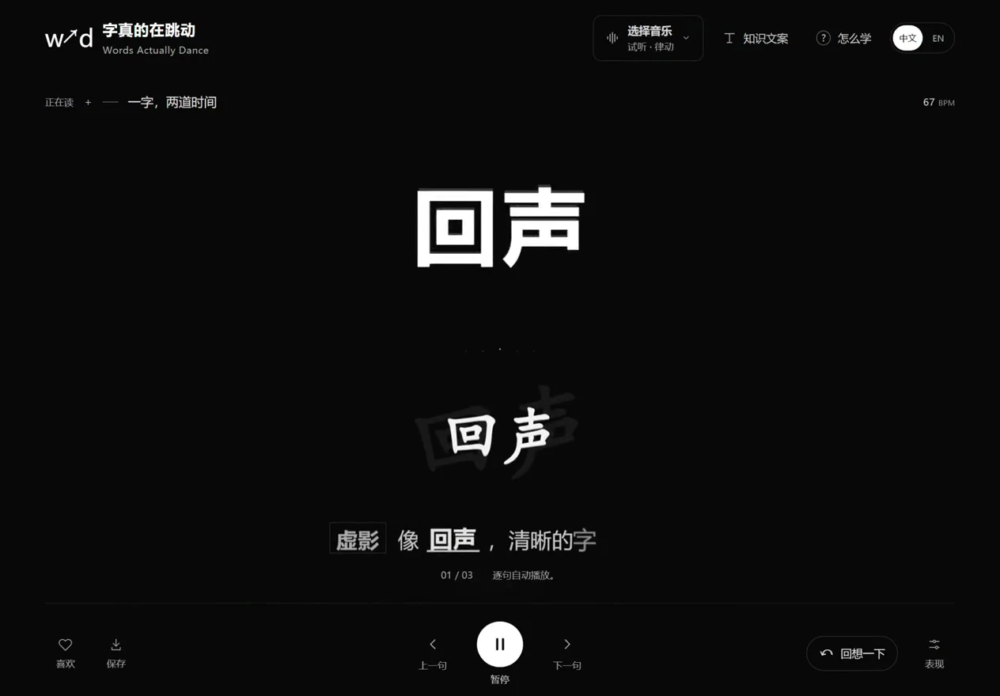
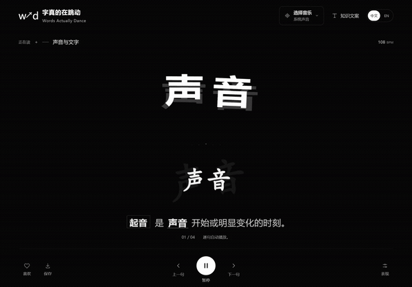
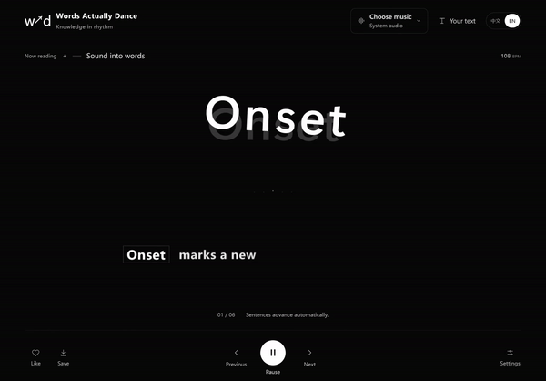
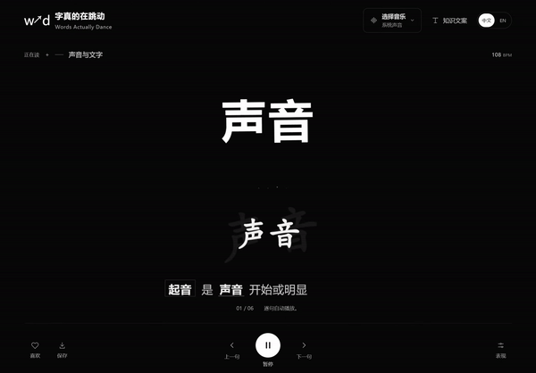
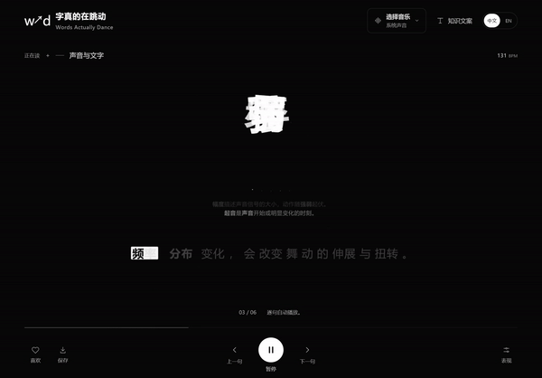
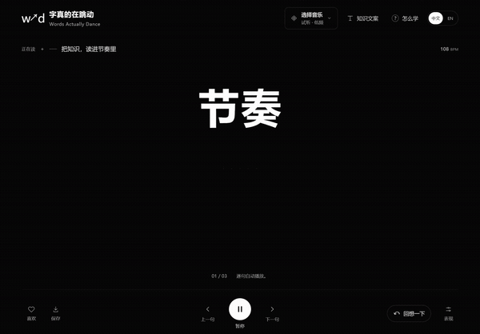
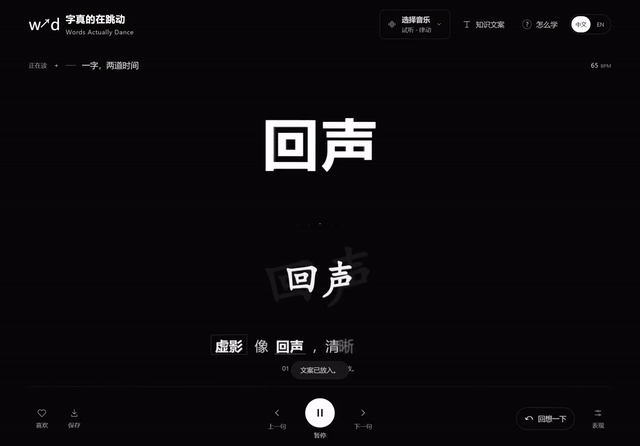
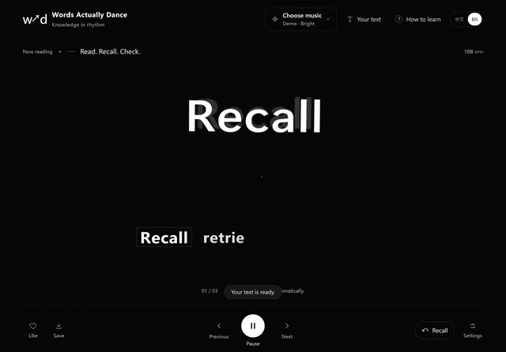

<p align="center"><a href="https://words-actually-dance-lab.aivnailedeng.chatgpt.site/"><strong>▶ 🎧 Try it in your browser · 在线体验</strong></a><br>English / 中文 · No installation · 无需安装</p>

<p align="center"><a href="#english">English</a> · <a href="#简体中文">简体中文</a> · <a href="#song-previews">🎵 Songs + previews / 歌曲＋对应预览</a> · <a href="media/demo-full.mp4">🎬 Full demo / 完整演示 · 32s</a> · <a href="https://github.com/LexZeon/words-actually-dance-open/releases/latest">💻 Windows</a></p>

<p align="center"></p>

# Words Actually Dance 🎵 字真的在跳动

## English

**Let knowledge move to your rhythm.**

Turn a paragraph of notes into words that unfold with music. Keywords move with the sound while explanations appear one sentence at a time. When an idea deserves a moment, press **Recall** and try explaining it in your own words.

[Open the website](https://words-actually-dance-lab.aivnailedeng.chatgpt.site/) · [Download Windows](https://github.com/LexZeon/words-actually-dance-open/releases/latest) · [Getting started](GETTING-STARTED.md#english) · [Learning guide](docs/learning-science.md#english) · [中文](#简体中文)

### Song previews

🎵 **Open a song · See its actual app preview**

**Choose a song below, then open its matching preview.** Each preview comes from the app recording driven by that particular track. The public MP4s and GIFs contain only our own app interface and original example text, **with the song audio removed**. Listen through the source links. These are visual demonstrations, not beat-accuracy benchmarks.

| ① Die For You                                                                                                                                                                                                                                                                                                                                                                             | ② 牵丝戏 · Qian Si Xi                                                                                                                                                                                                                                                                                                                                                                                                                                        |
| ----------------------------------------------------------------------------------------------------------------------------------------------------------------------------------------------------------------------------------------------------------------------------------------------------------------------------------------------------------------------------------------- | ------------------------------------------------------------------------------------------------------------------------------------------------------------------------------------------------------------------------------------------------------------------------------------------------------------------------------------------------------------------------------------------------------------------------------------------------------------ |
| **[🎧 OPEN SONG](https://www.bilibili.com/video/BV1Zopb6KEFo/)** · **[▶ ACTUAL PREVIEW · silent · 12s](media/song-die-for-you-silent.mp4)**<br>[](media/song-die-for-you-silent.mp4)<br>Original: **The Weeknd** · Video uploader: **大西洋电台**<br>Recorded song segment: **1:30–1:42**                  | **[🎧 OPEN SONG](https://www.bilibili.com/video/BV1Eqh9z1EcP/)** · **[▶ ACTUAL PREVIEW · silent · 34s](media/song-qian-si-xi-silent.mp4)**<br>[](media/song-qian-si-xi-silent.mp4)<br>Original vocals: **银临 / Aki阿杰** · Music: **银临** · Lyrics: **Vagary**<br>Video uploader: **南秋辞巷** · Segment: **1:19–1:53**                                                       |
| **③ 죽을 만큼 아파서 · Remix reference**                                                                                                                                                                                                                                                                                                                                                  | **④ 朋友的酒 · HALO DJ**                                                                                                                                                                                                                                                                                                                                                                                                                                     |
| **[🎧 OPEN SONG](https://www.bilibili.com/video/BV1Kmpc6zEi3/)** · **[▶ ACTUAL PREVIEW · silent · 61s](media/song-mc-mong-remix-silent.mp4)**<br>[](media/song-mc-mong-remix-silent.mp4)<br>Original: **MC몽 feat. 멜로우** · Referenced adaptation/remix: **清风最梦**<br>Segment: **2:04–3:05** | **[🎧 OPEN SONG](https://www.bilibili.com/video/BV1cn8t6tE5m/)** · **[▶ ACTUAL PREVIEW · silent · 57s](media/song-friends-wine-silent.mp4)**<br>[](media/song-friends-wine-silent.mp4)<br>Original singer: **李晓杰** · Words/music: **积木鱼**<br>Referenced synthesized-vocal/video version: **活跃黑江乐**<br>**Entire selected short source**, about 57 seconds |

Recorded in app **0.10.1**; the current app release is **0.10.2**. The 6-second looping GIFs are excerpts; each MP4 preserves the full recorded segment above. Further version credits and sources: [Music credits](MUSIC-CREDITS.md#english). Attribution is not a music licence.

### 🎬 Watch it move — with original audio

**[▶ Watch or download the complete 32-second demo](media/demo-full.mp4)** — three complete clips with different original audio styles, joined with simple cuts. All footage comes from the actual app; no long introduction or added animation. These are software demonstrations, not learning-effectiveness experiments.

The previews below animate directly in this README **without sound**. Select **▶ MP4** for a complete clip with audio; if GitHub shows a file page, use **View raw** or download it. GitHub does not automatically turn repository MP4 links into embedded video players.

| Preview                                                                         | Full video and what to notice                                                                                                                                                       |
| ------------------------------------------------------------------------------- | ----------------------------------------------------------------------------------------------------------------------------------------------------------------------------------- |
| [](media/demo-overview.mp4)     | **[▶ MP4 · 10s · Let knowledge follow the rhythm](media/demo-overview.mp4)**<br>Original bass and weighted percussion; short explanations and transitions between related keywords. |
| [](media/demo-ghosts.mp4) | **[▶ MP4 · 10s · One word, two moments](media/demo-ghosts.mp4)**<br>Original chord synths; five styles combining solid white text and a delayed translucent white ghost.            |
| [](media/demo-learning.mp4)    | **[▶ MP4 · 12s · Read, then recall](media/demo-learning.mp4)**<br>Original bright arpeggios; a real pause, concealed explanation, and manual reveal after recall.                   |

The music is generated by this project's code, and the example text is original. Individual clips run about 10–12 seconds.

🎵 Listening and interaction references, with original artists kept separate from video uploaders:

- **[The Weeknd — Die For You](https://www.bilibili.com/video/BV1Zopb6KEFo/)**; linked video uploaded by **大西洋电台**.
- **[牵丝戏, 1:19–1:53](https://www.bilibili.com/video/BV1Eqh9z1EcP/)**; original singers **银临 and Aki阿杰**, music **银临**, lyrics **Vagary**; linked version uploaded by **南秋辞巷**.
- **[清风最梦's adaptation/remix, 2:04–3:05](https://www.bilibili.com/video/BV1Kmpc6zEi3/)**; original song **죽을 만큼 아파서**, **MC몽 (MC MONG) feat. 멜로우 (Mellow)**.
- **[朋友的酒 — HALO DJ, complete short version](https://www.bilibili.com/video/BV1cn8t6tE5m/)**; original singer **李晓杰**, words and music **积木鱼**; linked synthesized-vocal/video version by **活跃黑江乐**. Further version credits remain unverified.

These recordings have not been licensed as this project's public-demo soundtracks. They are not embedded in our public videos or distributed with the repository or software. Links identify references; they do not imply permission, endorsement or collaboration. Full writer, arrangement, recording and version details: **[🎼 Music credits](MUSIC-CREDITS.md#english)**.

### 🚀 Start in three steps

1. **Choose music.** Press **Try it** first. Windows supports local music and explicitly enabled system-output analysis; reconnect after changing the output device. In supported browsers, the website can use a tab or screen shared with audio. The public website has no music-file upload or import.
2. **Bring knowledge.** Try the built-in material in either interface language, or import TXT / standard JSON. You can copy a prompt, prepare material in your preferred external AI tool, and import its result. The app makes no AI calls and never automatically translates your material.
3. **Read a little, then pause.** Adjust characters per beat and motion intensity; pause or revisit a sentence at any time. **Recall** pauses playback and conceals the explanation. **Show answer** only uncovers it; you choose when to continue.

### 🧠 Make room for understanding

The keyword stage and knowledge text have independent renderers. Real audio onsets and drum weight influence their accents; frequency distribution, amplitude, beat phase and timbre proxies continuously change the motion. A shared internal beat clock keeps playback continuous. Five white ghost styles can be automatic, fixed or disabled; the knowledge area retains 22 text effects. The clock continues during quiet passages, which does not mean a real drum hit was detected.

Reading a short section, recalling it, checking the source and trying again later are workflows you can explore. Retrieval practice and spaced practice have research support; **this app's music, animation and overall learning effectiveness have not been validated**. If motion or music interferes with understanding, reduce movement, lower the volume or read in quiet. Instrumental music is not guaranteed to be better for learning. [Research, examples and limits](docs/learning-science.md#english).

### 💻 Run it on your computer

Most users should download the Windows portable build, extract and keep the entire folder, then double-click the launcher. There is currently no code signature or installer. Obtain builds from this repository's Releases and check the published SHA-256.

Developers need Node.js 22.13+ and pnpm 11.25:

```sh
git clone https://github.com/LexZeon/words-actually-dance-open.git
cd words-actually-dance-open
pnpm install --frozen-lockfile
pnpm preview
```

Open the local address printed in the terminal. Use `pnpm start` for the Windows app, choose your display on first launch, and use `pnpm package:win` to generate a portable folder. The browser preview offers generated demo audio and consent-based shared audio where supported; the public browser experience has no music-file import. Windows retains local music selection.

### ✨ Open-source scope

This is an experimental open-source player for use, research and further improvement. A Windows experimental build and a locally runnable web interface are available. Native Android, iOS and macOS releases, accounts, recommendations, billing, online AI and speech synthesis are not implemented. Beat and half/double-tempo detection can still be wrong on complex music; timbre labels are sound-feature proxies.

The public website opens directly, provides Chinese and English, external-AI prompts and local text import, and uses generated demo audio or browser-authorized shared audio without music upload. The desktop app keeps local music selection. This separate public release excludes private development history, chats, collaborator details, private library identities and uploaded files. It does not connect to the former collaboration library or silently upload your music and notes. [Privacy](PRIVACY.md#english).

First-party code, original example text and project-generated demo media use the [MIT licence](LICENSE). Electron / Chromium and other third-party components retain their own licences. [Components and methodological inspiration](THIRD-PARTY-NOTICES.md#english) and [original artists / version credits](MUSIC-CREDITS.md#english) are recorded separately. MIT does not grant rights to music, textbooks, fonts or third-party material you import.

Issues and contributions are welcome. There is no promised update schedule. Reproduction steps, descriptions of the music's features and small examples without private material make issues easier to investigate. [Contributing](CONTRIBUTING.md#english).

---

## 简体中文

**让知识，跟上你的节奏。**

把一段笔记变成随音乐展开的文字。关键词踩着声音起势，讲解一句句出现；读到值得停一下的地方，按「回想一下」，试着用自己的话说出来。

[打开网站](https://words-actually-dance-lab.aivnailedeng.chatgpt.site/) · [下载 Windows 便携版](https://github.com/LexZeon/words-actually-dance-open/releases/latest) · [开始使用](GETTING-STARTED.md#简体中文) · [怎么学](docs/learning-science.md#简体中文) · [English](#english)

### 歌曲预览

🎵 **打开歌曲 · 看对应的实际程序预览**

**每首歌都能直接打开，并配有对应预览。** 每个预览都来自这首歌驱动程序时的实际录屏。公开 MP4 与动图只包含自有软件界面及原创示例文案，**已去除原曲声音**；请通过原链接听歌。这些是视觉演示，不是拍点准确率测试。

| ① Die For You                                                                                                                                                                                                                                                                                                                                               | ② 牵丝戏                                                                                                                                                                                                                                                                                                                                                                         |
| ----------------------------------------------------------------------------------------------------------------------------------------------------------------------------------------------------------------------------------------------------------------------------------------------------------------------------------------------------------- | -------------------------------------------------------------------------------------------------------------------------------------------------------------------------------------------------------------------------------------------------------------------------------------------------------------------------------------------------------------------------------- |
| **[🎧 打开歌曲](https://www.bilibili.com/video/BV1Zopb6KEFo/)** · **[▶ 对应实录预览 · 无声 · 12秒](media/song-die-for-you-silent.mp4)**<br>[](media/song-die-for-you-silent.mp4)<br>原演唱：**The Weeknd** · 视频上传者：**大西洋电台**<br>录制片段：**1:30–1:42**                        | **[🎧 打开歌曲](https://www.bilibili.com/video/BV1Eqh9z1EcP/)** · **[▶ 对应实录预览 · 无声 · 34秒](media/song-qian-si-xi-silent.mp4)**<br>[](media/song-qian-si-xi-silent.mp4)<br>原唱：**银临 / Aki阿杰** · 曲：**银临** · 词：**Vagary**<br>视频上传者：**南秋辞巷** · 片段：**1:19–1:53**                         |
| **③ 죽을 만큼 아파서 · 改编参考**                                                                                                                                                                                                                                                                                                                           | **④ 朋友的酒 · HALO DJ**                                                                                                                                                                                                                                                                                                                                                         |
| **[🎧 打开歌曲](https://www.bilibili.com/video/BV1Kmpc6zEi3/)** · **[▶ 对应实录预览 · 无声 · 61秒](media/song-mc-mong-remix-silent.mp4)**<br>[](media/song-mc-mong-remix-silent.mp4)<br>原演唱：**MC몽 feat. 멜로우** · 参考改编／remix创作者：**清风最梦**<br>片段：**2:04–3:05** | **[🎧 打开歌曲](https://www.bilibili.com/video/BV1cn8t6tE5m/)** · **[▶ 对应实录预览 · 无声 · 57秒](media/song-friends-wine-silent.mp4)**<br>[](media/song-friends-wine-silent.mp4)<br>原唱：**李晓杰** · 词曲：**积木鱼**<br>所选合成歌声／视频版本创作者：**活跃黑江乐**<br>**所选短版完整源曲**，约57秒 |

这些录屏使用 **0.10.1**，当前程序发行版为 **0.10.2**。动图为6秒循环摘录，各 MP4 保留上述完整录制片段。其他版本署名与来源见[音乐署名](MUSIC-CREDITS.md#简体中文)。署名不代替音乐授权。

### 🎬 先看它怎么动——带原创配乐

**[▶ 播放或下载完整32秒演示](media/demo-full.mp4)**：三段不同原创配乐风格的完整片段，用简单切镜合并。全部直接录制实际程序，不加长片头或额外动画。它们展示软件表现，不是学习效果实验。

下方动图可直接在 README 中观看，**不带声音**。点击 **▶ MP4** 打开有声完整片段；若 GitHub 显示文件页，点 **View raw** 或下载。GitHub 不会把仓库 MP4 链接自动变成内嵌播放器。

| 动图预览                                                               | 完整视频与看点                                                                                                         |
| ---------------------------------------------------------------------- | ---------------------------------------------------------------------------------------------------------------------- |
| [](media/demo-overview.mp4) | **[▶ MP4 · 10秒 · 让知识跟上节奏](media/demo-overview.mp4)**<br>原创低频重鼓、声音轻重、逐句讲解与关联关键词交接。     |
| [](media/demo-ghosts.mp4)     | **[▶ MP4 · 10秒 · 一字，两道时间](media/demo-ghosts.mp4)**<br>原创和弦合成器、五种清晰白字与延迟淡白虚影。             |
| [](media/demo-learning.mp4)   | **[▶ MP4 · 12秒 · 读过之后，回想一下](media/demo-learning.mp4)**<br>原创明亮琶音、实际暂停、遮住讲解、回想后手动核对。 |

配乐由本项目代码生成，文字为原创示例。每条约10–12秒。

🎵 聆听与联动参考，原作者与视频上传者分别署名：

- **[The Weeknd《Die For You》](https://www.bilibili.com/video/BV1Zopb6KEFo/)**，视频上传者为**大西洋电台**。
- **[《牵丝戏》参考版本，1:19–1:53](https://www.bilibili.com/video/BV1Eqh9z1EcP/)**，原唱**银临、Aki阿杰**，曲**银临**、词**Vagary**，版本上传者**南秋辞巷**。
- **[清风最梦的改编／remix版本，2:04–3:05](https://www.bilibili.com/video/BV1Kmpc6zEi3/)**，原曲**《죽을 만큼 아파서》**，**MC몽（MC MONG）feat. 멜로우（Mellow）**。
- **[《朋友的酒》HALO DJ完整短版](https://www.bilibili.com/video/BV1cn8t6tE5m/)**，原唱**李晓杰**、词曲**积木鱼**，所选合成歌声／视频版本创作者**活跃黑江乐**。进一步版本署名仍待核实。

这些录音未获本项目公开视频配乐授权，不嵌入公开视频、不随仓库或软件分发；链接用于标明参考来源，不表示许可、支持或合作。完整原作词曲、编曲、录音与版本来源见 **[🎼 音乐署名](MUSIC-CREDITS.md#简体中文)**。

### 🚀 三步开始

1. **选音乐。** 先按「开始试听」。Windows 可选择本地音乐，也能在主动开启后分析系统声音；换输出设备后重新连接。网页可在浏览器支持时共享带音频的标签页或屏幕。公开网站不提供音乐文件上传或导入。
2. **放知识。** 中英文界面都可试读内置文案，或导入 TXT／标准 JSON。也能复制提示词，在自己选择的 AI 工具里整理材料后再导入。软件本身不调用 AI，也不会自动翻译你的材料。
3. **读一小段，停一下。** 调整每拍文字和动作强度，随时暂停、回看。点「回想一下」会暂停播放并遮住讲解；「看答案」只揭开内容，由你决定何时继续。

### 🧠 好看，也给理解留点空间

关键词舞台与知识文字各有独立渲染器：真实起音和鼓点重量影响动作，频率分布、幅度、节拍相位与音色代理持续改变姿态；统一内部拍子让播放保持连贯。五种白字虚影可自动选择、固定或关闭，知识区保留22种文字效果。安静时内部拍子会继续，这不表示程序检测到了真实鼓点。

一次只读一小段、回想后核对、隔一段时间再试，是可以尝试的学习流程。检索练习与间隔学习有研究支持；**本软件的音乐、动画及整体学习效果尚未经有效性研究**。如果动画或音乐干扰理解，就调轻动作、调低音量，或安静地读；无歌词音乐也不保证更适合学习。[研究、例子与边界](docs/learning-science.md#简体中文)。

### 💻 在自己电脑上运行

普通用户优先下载 Windows 便携版，解压后保留整个文件夹，双击启动文件。当前没有代码签名或安装器；请只从本仓库 Releases 获取并核对发布的 SHA-256。

开发者需要 Node.js 22.13+、pnpm 11.25：

```sh
git clone https://github.com/LexZeon/words-actually-dance-open.git
cd words-actually-dance-open
pnpm install --frozen-lockfile
pnpm preview
```

浏览器打开终端给出的本地地址。Windows 原生版使用 `pnpm start`，首次选择自己的屏幕；`pnpm package:win` 生成便携目录。浏览器预览提供内置试听，以及浏览器支持时由用户授权的共享声音；公开浏览器体验不提供音乐文件导入，Windows 保留本地音乐选择。

### ✨ 开源范围

这是一个实验性开源播放器，适合使用、研究与继续改进。目前支持 Windows 实验版和可本地运行的网页；Android、iOS、macOS 原生发行版、账号、推荐、付费、在线 AI 与配音均未接入。复杂音乐的节拍／倍拍判断仍可能出错，音色名称只是声音特征代理。

公开网站可直接访问，提供中英文、提示词和本地文案导入；不提供音乐上传，使用内置试听或浏览器授权共享声音。桌面版保留本地音乐选择。公开版本独立发布，不包含原私有开发历史、聊天、协作者资料、私人云库身份和上传文件，不连接原协作库，不会默默上传你的音乐和笔记。[隐私说明](PRIVACY.md#简体中文)。

自有代码、原创示例文字与本仓库自产演示媒体采用 [MIT](LICENSE)。Electron／Chromium 等第三方组件保留各自许可，[组件与方法灵感](THIRD-PARTY-NOTICES.md#简体中文)、[音乐原作者与版本署名](MUSIC-CREDITS.md#简体中文)分别记录。MIT 不授予用户导入音乐、教材、字体或第三方素材的权利。

欢迎提交问题或接手改进。不承诺固定更新周期；复现步骤、音乐特征描述和不含私人材料的小样例，会让问题更容易处理。[贡献指南](CONTRIBUTING.md#简体中文)。
